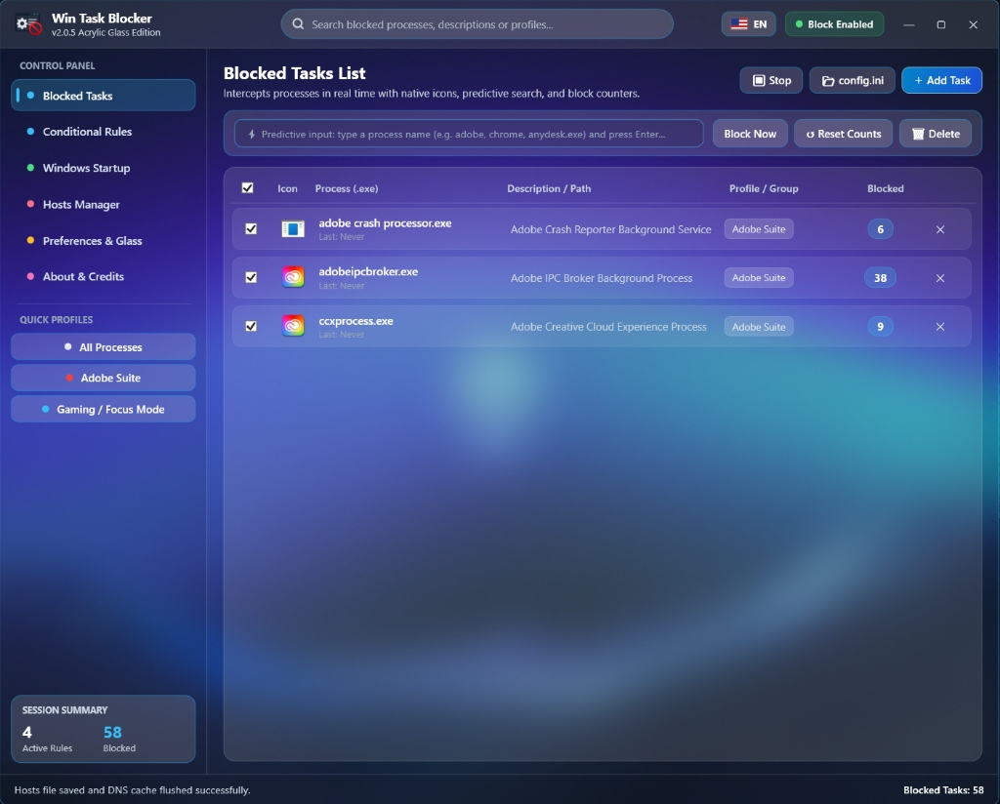
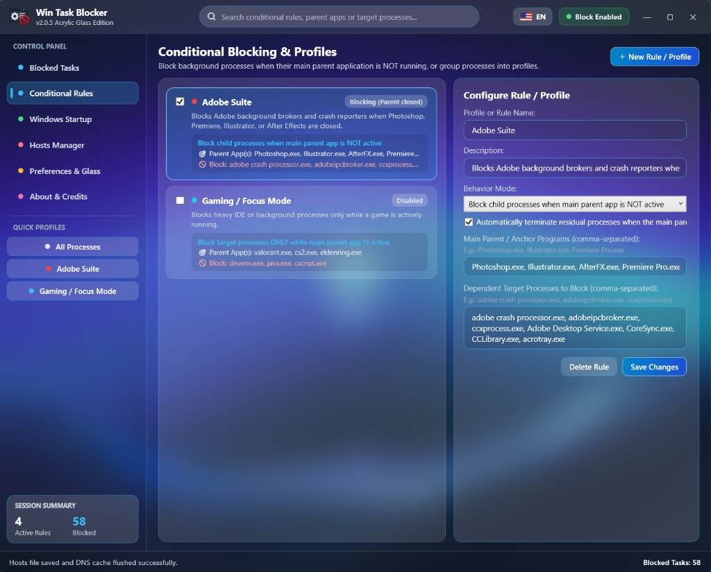
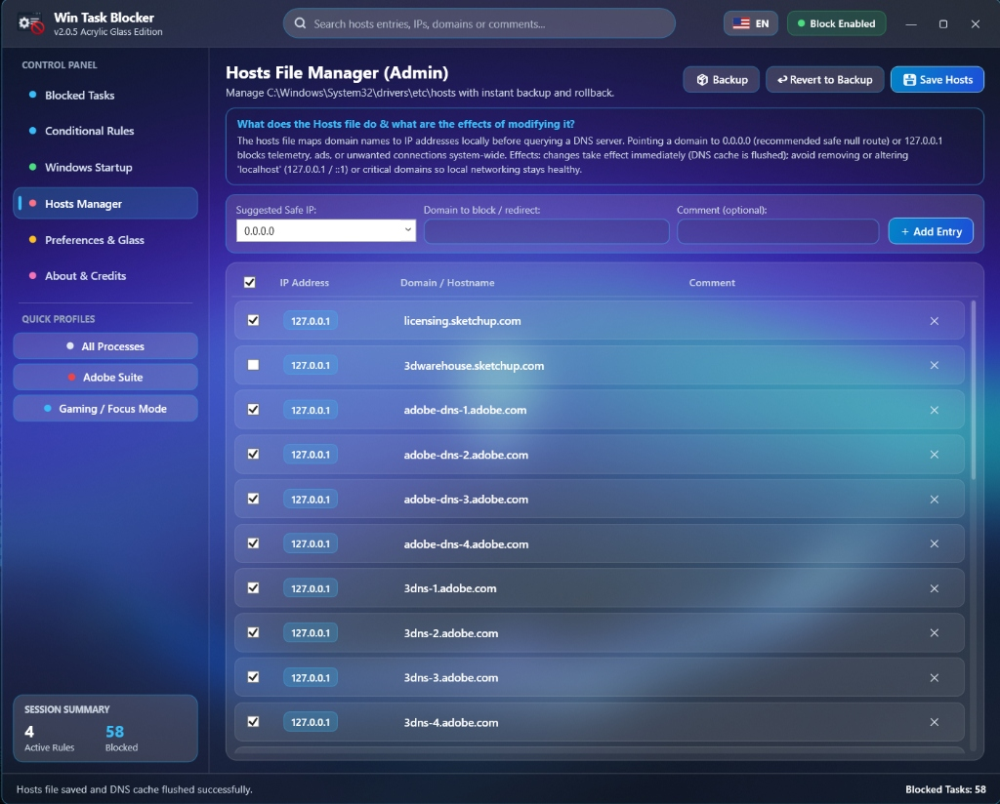
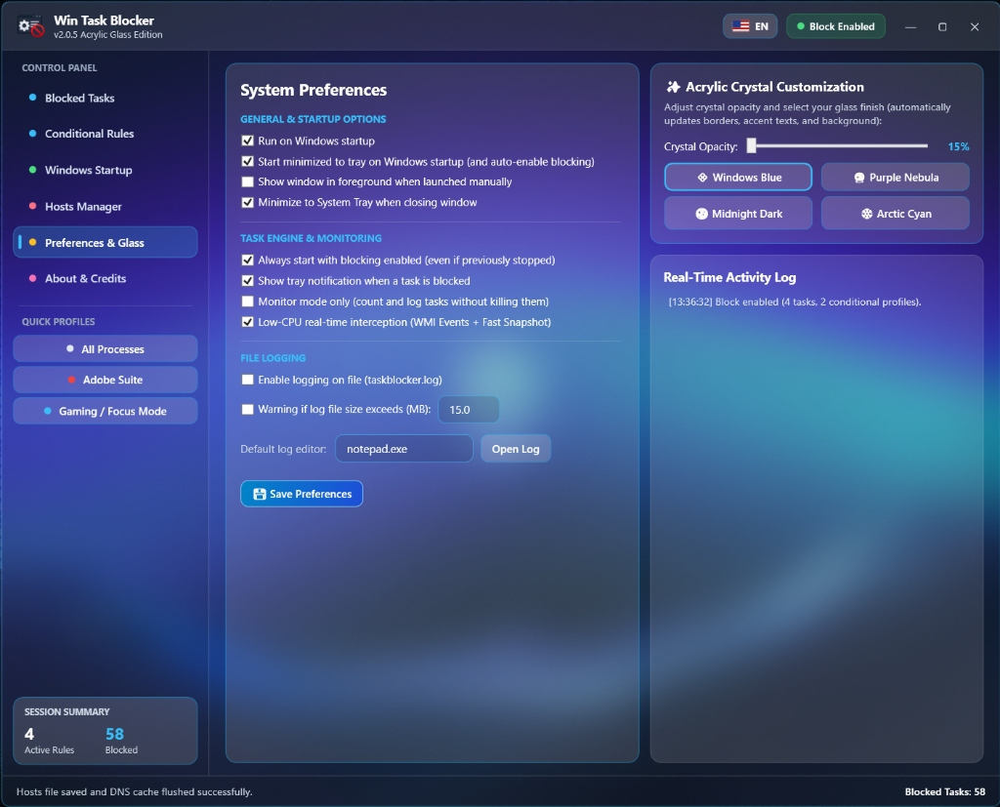
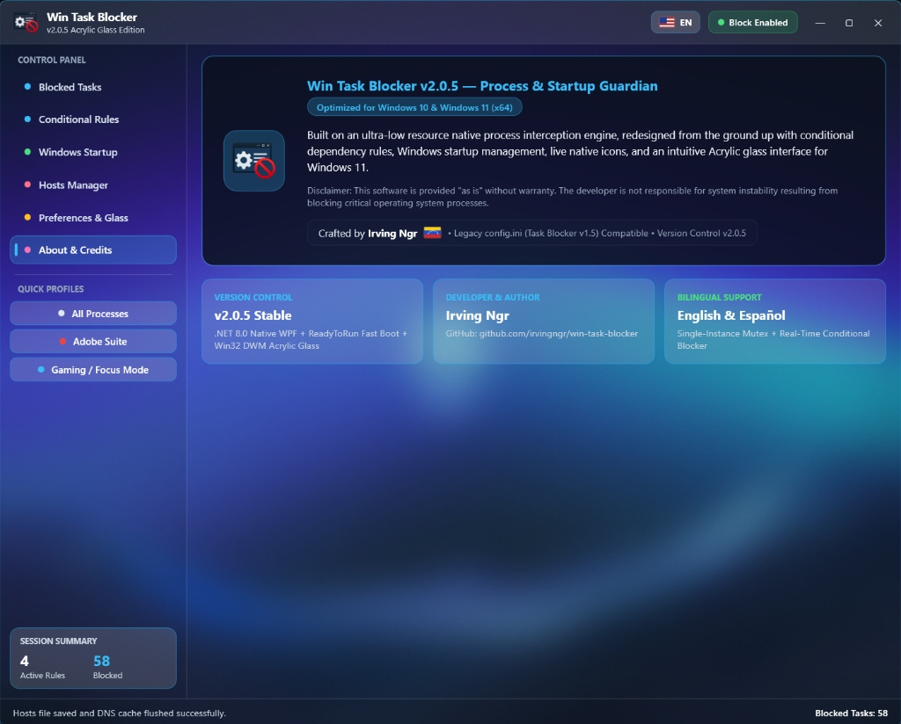

<p align="center">
  
</p>

<h1 align="center">Win Task Blocker</h1>

<p align="center">
  <strong>Modern, ultra-lightweight process blocker, conditional dependency guardian, Windows startup manager, and Hosts file manager for Windows 10 &amp; Windows 11.</strong>
</p>

<p align="center">
  
  
  
  
  
</p>

---

## ✨ Key Features

1. **Real-Time Process Blocker & Predictive Search**:
   - Intercepts and terminates unwanted executables in real time using a low-CPU background engine + WMI process trace events (`SeDebugPrivilege` + multi-stage Win32 `TerminateProcess`).
   - **Predictive Autocomplete Search**: Filter active processes or type executable names with instant suggestions, native `.exe` icon extraction, and block counters.
   - **Quick Toggle & Context-Aware Search**: Toggle protection anytime from the top **Block Enabled / Block Disabled** button or the System Tray icon, and filter across **Blocked Tasks**, **Conditional Rules**, **Windows Startup**, and **Hosts Manager**.
2. **Conditional Blocking & Dynamic Profiles**:
   - **Parent/Child Dependency Guardian**: Automatically block background services or telemetry (such as `adobe crash processor.exe`, `adobeipcbroker.exe`, `ccxprocess.exe`, `CoreSync.exe`, `CCLibrary.exe`) **only when their main parent applications** (`Photoshop.exe`, `Illustrator.exe`, `AfterFX.exe`, `Premiere Pro.exe`, `Acrobat.exe`) are closed—or block heavy tools while a game is running (**Gaming / Focus Mode**).
   - **Dynamic Quick Profiles**: Adding, editing, or deleting profiles immediately updates the **Quick Profiles** sidebar.
3. **Windows Automatic Startup Manager (Full Task Manager Parity)**:
   - Inspect, enable, disable, add, or remove startup programs across **all Windows Task Manager sources**: 64-bit Registry (`HKCU\...\Run`, `HKLM\...\Run` + `StartupApproved\Run`), 32-bit WOW64 Registry (`HKLM\SOFTWARE\WOW6432Node\...\Run` + `StartupApproved\Run32`), User & Common Startup folders (`%APPDATA%\...\Startup` & `%ProgramData%\...\Startup` + `StartupApproved\StartupFolder`), and packaged UWP/MSIX apps (`AppModel\SystemAppData`).
4. **Hosts File Manager (Admin)**:
   - Edit `C:\Windows\System32\drivers\etc\hosts` directly from a clean visual table with **suggested safe blocking IPs** (`0.0.0.0`, `127.0.0.1`, `::1`), enable/disable toggles (`#`), one-click **Backup**, **Revert to Backup**, and automatic **DNS cache flush** (`ipconfig /flushdns`) on save.
5. **Native Acrylic Glass Interface & Dynamic Crystal Accents**:
   - Borderless integrated header with native Windows 10/11 DWM Acrylic Blur and single 8px rounded corners.
   - Real-time **Crystal Opacity Slider** (`15%` – `95%`) and 4 selectable crystal finishes (**Windows Blue**, **Purple Nebula**, **Midnight Dark**, and **Arctic Cyan**) that dynamically update glass tint, button borders, badges, and accented texts.
6. **Instant Cold-Boot, Native Splash Screen & Minimized Windows Startup**:
   - Compiled with **ReadyToRun (R2R)** native precompilation and asynchronous background `.exe` icon resolution, accompanied by a native **Splash Screen**.
   - Includes **"Run on Windows startup (minimized)"** via Task Scheduler XML (works reliably on battery or AC power) and automatically starts in **Block Enabled** mode.
7. **Single-Instance Guard & Legacy `config.ini` Compatibility**:
   - Enforces a single running instance via a system-wide `Mutex` (re-launching brings the active window to the front).
   - Reads and writes the classic `True|process.exe|count` format (`config.ini`) alongside `taskblocker.state.json`.

---

## 📸 Screenshots

<p align="center">
  
  <br/>
  <em>Real-time Blocked Tasks List with native .exe icons, predictive search, and Quick Profiles</em>
</p>

<p align="center">
  
  <br/>
  <em>Conditional Blocking &amp; Profiles (Adobe Suite &amp; Gaming / Focus Mode)</em>
</p>

<p align="center">
  
  <br/>
  <em>Admin Hosts File Manager with safe suggested IPs, backup, and one-click rollback</em>
</p>

<p align="center">
  
  <br/>
  <em>System Preferences, Acrylic Crystal Customization, and Real-Time Activity Log</em>
</p>

<p align="center">
  
  <br/>
  <em>About &amp; Credits</em>
</p>

---

## 📦 Download & Build

### Download Portable Release
Download the latest single-file portable executable (`WinTaskBlocker.exe`) directly from the [**Releases**](https://github.com/irvingngr/win-task-blocker/releases) page. No installation required.

### Build from Source (.NET 8 SDK)
```powershell
dotnet publish WinTaskBlocker.csproj -c Release -r win-x64 --self-contained true -p:PublishSingleFile=true -p:PublishReadyToRun=true -p:EnableCompressionInSingleFile=false -o publish
```

---

## 👤 Credits & Version Control

- **Crafted by**: **Irving Ngr**
- **Current Version**: `v2.0.6`
- **Compatibility**: Legacy Task Blocker v1.5 `config.ini` format
- **Available Languages**: Also available in both **English** and **Spanish** (`EN` / `ES`) — switch anytime via the flag button in the titlebar.
